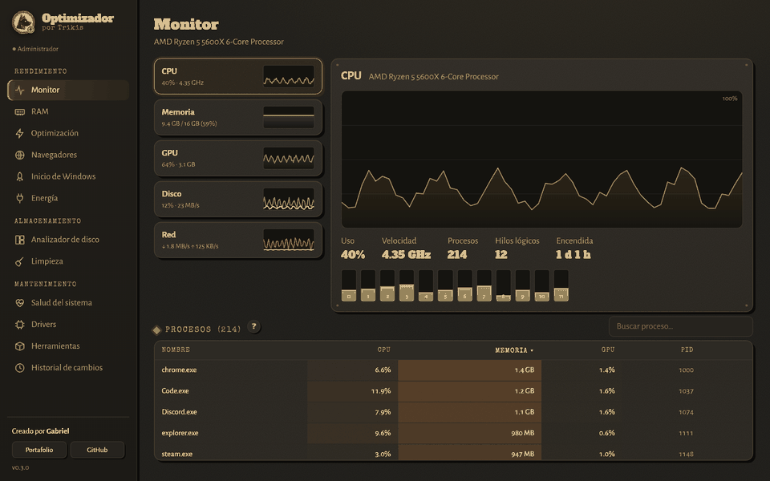
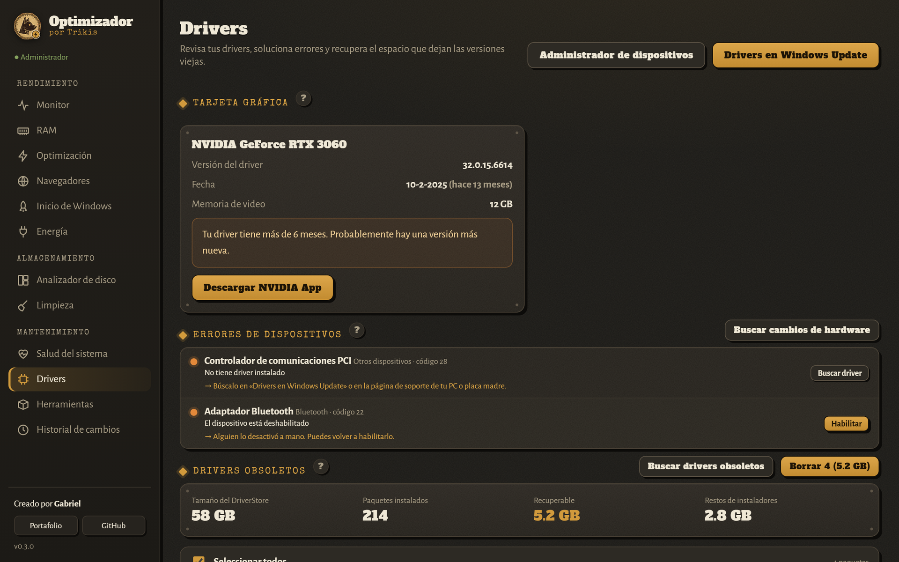
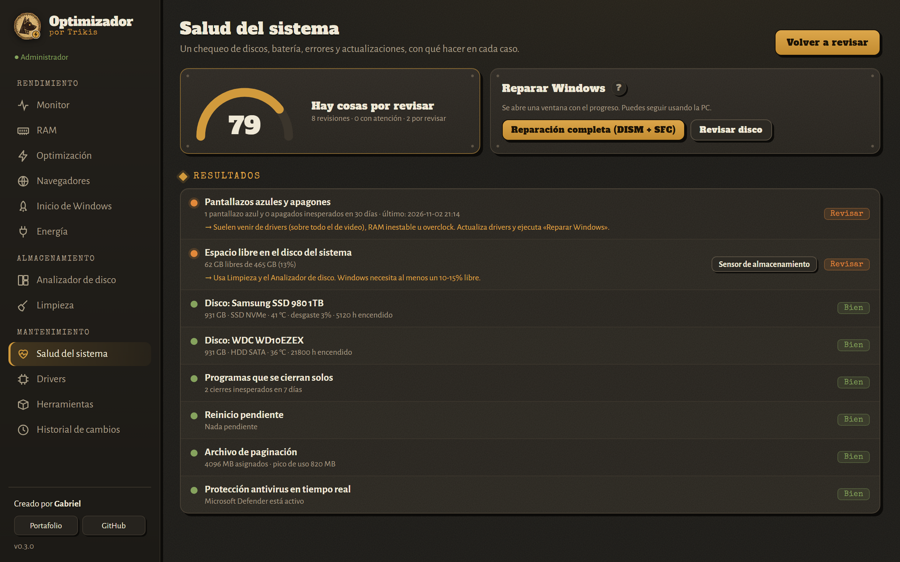
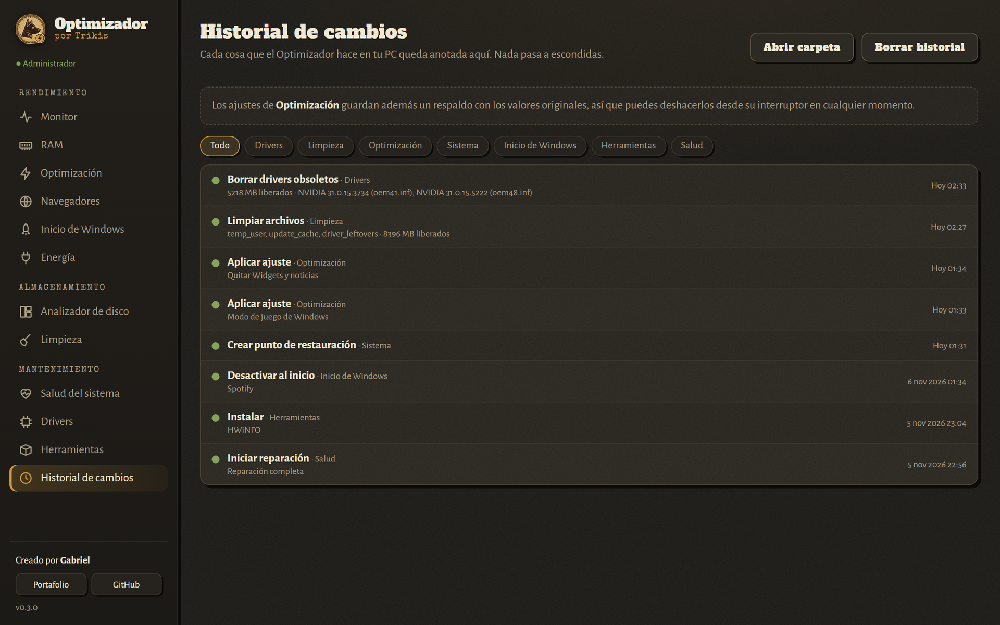
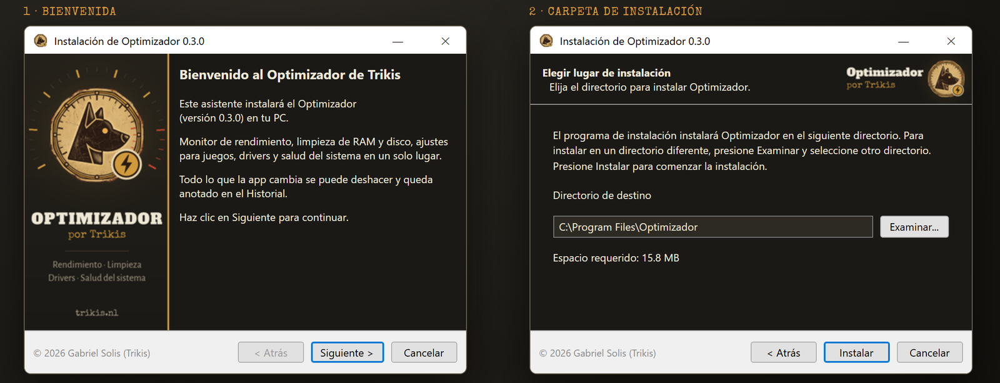

<p align="center"></p>

# Optimizador para PC · por Trikis

App de escritorio para Windows hecha con **Tauri 2** (Rust + HTML/CSS/JS).
Creado por Gabriel · [Portafolio](https://trikis.nl/)

### ⬇️ [Descargar la última versión](https://github.com/Trikis67/Optimizador/releases/latest)

> Si Windows muestra «Windows protegió tu PC», haz clic en **Más información → Ejecutar de todas formas**.

## Capturas

<p align="center"></p>

| Monitor | Optimización |
|---|---|
|  |  |

| Drivers | Salud del sistema |
|---|---|
|  |  |

| RAM | Limpieza |
|---|---|
|  |  |

| Navegadores | Historial de cambios |
|---|---|
|  |  |

**Instalador**



<sub>Las capturas usan datos de ejemplo.</sub>

## Novedades de la v0.3

- **Nuevo diseño** con la identidad de Trikis (colores, tipografías y logo propio del Optimizador).
- **Instalador personalizado** en español, con imágenes y textos de la marca.
- **Siempre como administrador:** la versión instalada pide permisos al abrirse, así todas las funciones están disponibles.
- **Drivers obsoletos:** encuentra y borra versiones viejas de drivers que Windows guarda en el DriverStore
  (con NVIDIA pueden ser decenas de GB) y los restos de instaladores en `C:\NVIDIA` y `C:\AMD`.
- **Guía de errores de dispositivos:** qué significa cada código de error y cómo arreglarlo, con botones para habilitar
  el dispositivo o buscar cambios de hardware.
- **Salud del sistema:** puntaje general, estado SMART de los discos, batería, pantallazos azules, reinicios pendientes,
  archivo de paginación, antivirus y reparación de Windows (DISM + SFC, CHKDSK).
- **Historial de cambios:** todo lo que la app hace queda anotado con fecha y resultado.
- **Optimización para PCs de bajos recursos:** nueva pestaña con ajustes que ahorran RAM y escrituras en disco
  (quitar Widgets y Copilot, agrupar servicios de Windows, no anotar el último acceso a archivos, actualizar la Tienda
  a mano, pantalla de bloqueo sin descargas). Cada ajuste dice si conviene **para tu PC**.
- **Más ajustes de Gaming:** sin limitación de energía en escritorio, optimizaciones para juegos en ventana (Windows 11)
  y más CPU para la ventana activa.
- **Limpieza:** nuevas categorías (restos de drivers, logs de Windows, caché de Internet de Windows).

## Secciones

**Rendimiento**
- **Monitor:** CPU (por núcleo y GHz), memoria, GPU, disco y red en tiempo real, con gráficas y lista de procesos (ordenar, buscar, finalizar).
- **RAM:** cómo está repartida la memoria (en uso, modificada, caché, libre), limpieza estilo Mem Reduct y limpieza automática.
- **Optimización:** ajustes de Gaming, Bajos recursos, Sistema, Privacidad y Servicios. Cada uno tiene un botón **?** que explica qué hace,
  sus ventajas, qué tener en cuenta y si se recomienda **para tu PC** (según RAM, disco SSD/HDD, GPU y laptop/escritorio).
  Todo se puede deshacer: antes de aplicar se guarda un respaldo en `%LOCALAPPDATA%\Optimizador\respaldo.json`.
- **Navegadores:** limpieza de caché (sin tocar historial, contraseñas ni cookies) y ajustes para Chrome, Edge y Brave.
- **Inicio de Windows:** activar o desactivar programas que se abren al encender la PC.
- **Energía:** plan de Máximo rendimiento.

**Almacenamiento**
- **Analizador de disco:** treemap tipo WizTree, archivos más grandes y tipos de archivo.
- **Limpieza:** temporales, Windows Update, caché de shaders, miniaturas, volcados de errores y papelera.

**Mantenimiento**
- **Salud del sistema:** chequeo con puntaje y reparaciones de Windows.
- **Drivers:** versión y antigüedad del driver de video, guía de errores de dispositivos y limpieza de drivers obsoletos.
- **Herramientas:** instala con winget Mem Reduct, HWiNFO, MSI Afterburner, CrystalDiskInfo, DDU y más.
- **Historial de cambios:** registro de cada acción (`%LOCALAPPDATA%\Optimizador\historial.json`).

## Cómo correrlo

```
npm install
npm run dev
```

Muchas funciones (servicios, ajustes del sistema, limpiar la caché de RAM) necesitan **permisos de administrador**.
En modo desarrollo: cierra VS Code, ábrelo con clic derecho → *Ejecutar como administrador* y corre `npm run dev`.
La versión instalada se abre siempre como administrador (manifiesto en `src-tauri/admin-manifest.xml`,
solo para la compilación final).

Para crear el instalador: `npm run build` (queda en `src-tauri/target/release/bundle/nsis/`).

## Marca e instalador

- `branding/variante_logo.py` crea la variante del logo (medallón con velocímetro y rayo). Después: `npx tauri icon docs/logo.png`.
- `branding/instalador_imagenes.py` genera `src-tauri/installer/sidebar.bmp` y `header.bmp`.
- `src-tauri/installer/hooks.nsh` cambia los colores y textos del asistente de instalación.

## Estructura

```
src/
  index.html, styles.css
  js/app.js            navegación y arranque
  js/util.js           utilidades (formato, diálogos, ayuda "?")
  js/tweakpanel.js     tarjetas de ajustes reutilizables
  js/chart.js          gráficas del monitor
  js/pages/*.js        una página por sección
  fonts/, img/         tipografías y logo (incluidos, funcionan sin internet)
src-tauri/src/
  main.rs              comandos que llama la interfaz
  perf.rs, pdh.rs      monitor (sysinfo + contadores de rendimiento de Windows)
  memory.rs            limpieza de RAM
  tweaks.rs            catálogo de optimizaciones, respaldo y deshacer
  hw.rs                detección de hardware para las recomendaciones
  health.rs            salud del sistema y reparaciones
  history.rs           historial de cambios
  browsers.rs, cleaner.rs, startup.rs, drivers.rs, tools.rs
  winreg.rs, sysutil.rs  registro de Windows, PowerShell, permisos
  scanner.rs, power.rs, monitor.rs
```

## Pruebas

`cd src-tauri` y luego `cargo test`.
