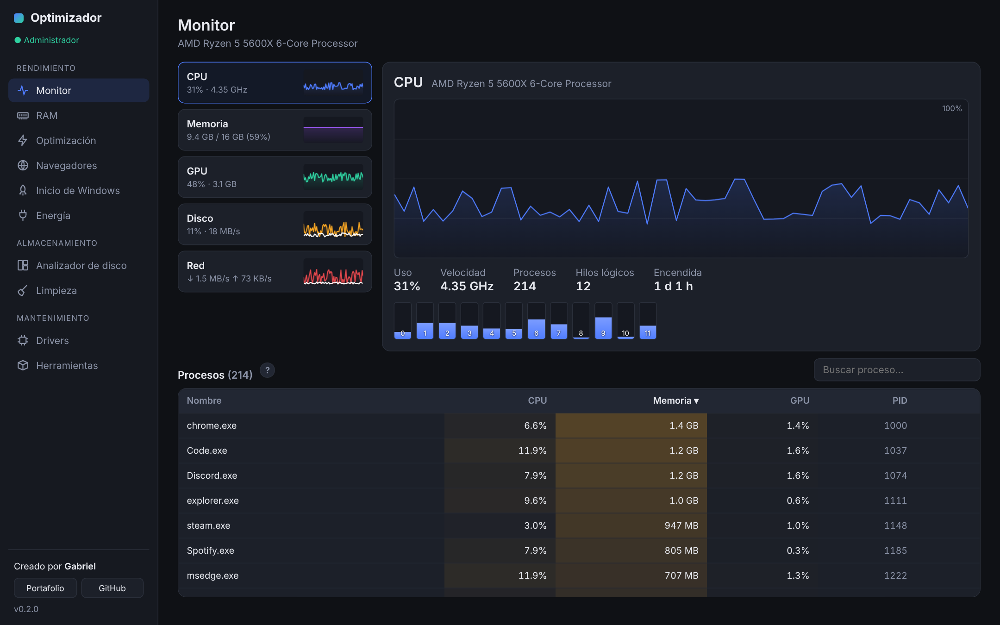
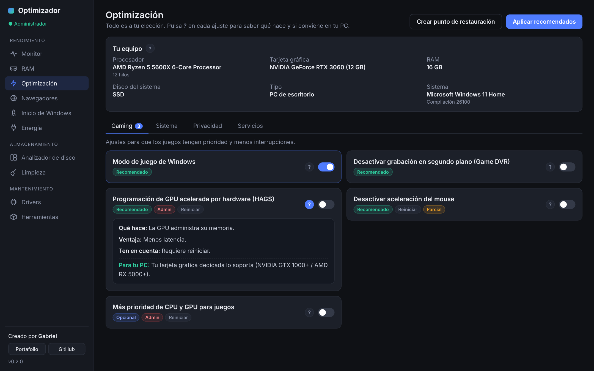
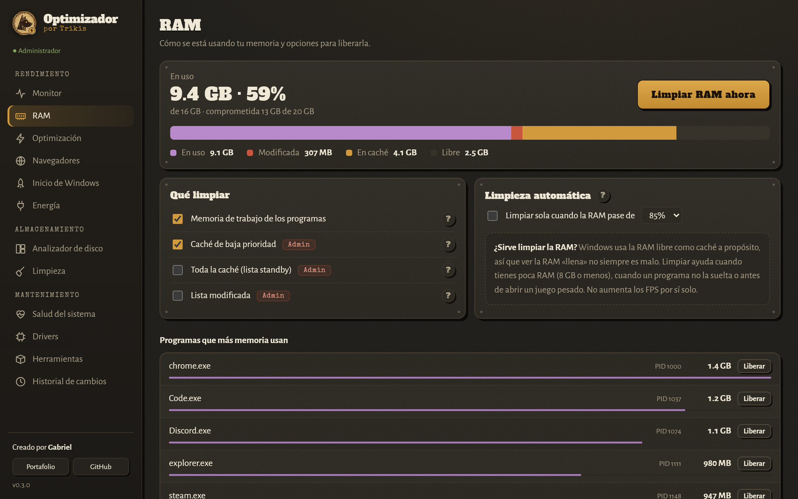
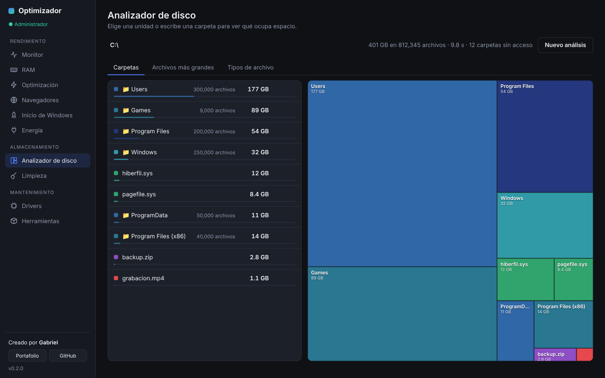
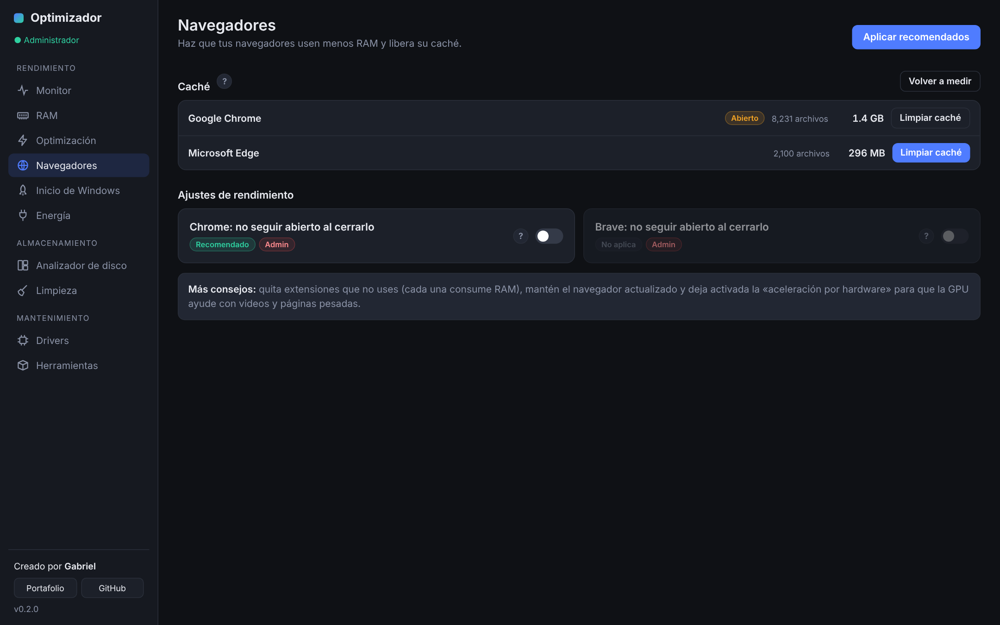
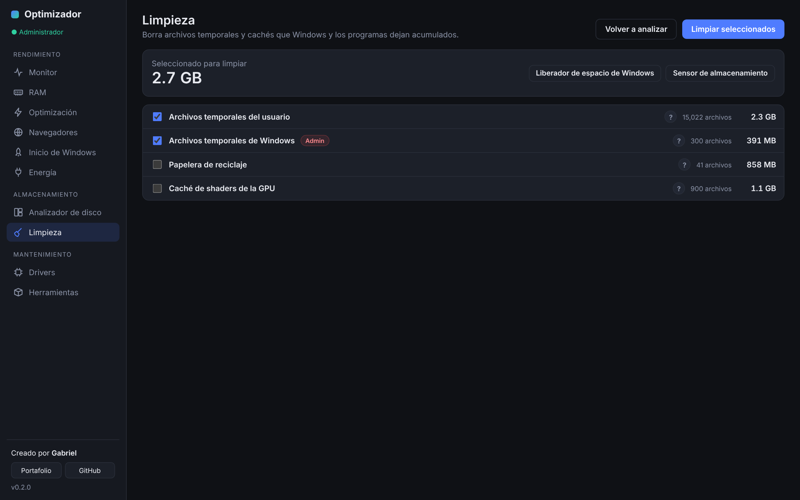

# Optimizador para PC

App de escritorio para Windows hecha con **Tauri 2** (Rust + HTML/CSS/JS).
Creado por Gabriel · [Portafolio](https://trikis.nl/)

### ⬇️ [Descargar la última versión](https://github.com/Trikis67/Optimizador/releases/latest)

> Si Windows muestra «Windows protegió tu PC», haz clic en **Más información → Ejecutar de todas formas**.

## Capturas

| Monitor | Optimización |
|---|---|
|  |  |

| RAM | Analizador de disco |
|---|---|
|  |  |

| Navegadores | Limpieza |
|---|---|
|  |  |

## Secciones (v0.2)

**Rendimiento**
- **Monitor:** CPU (por núcleo y GHz), memoria, GPU, disco y red en tiempo real, con gráficas y lista de procesos (ordenar, buscar, finalizar).
- **RAM:** cómo está repartida la memoria (en uso, modificada, caché, libre), limpieza estilo Mem Reduct y limpieza automática.
- **Optimización:** ajustes de Gaming, Sistema, Privacidad y Servicios. Cada uno tiene un botón **?** que explica qué hace,
  sus ventajas, qué tener en cuenta y si se recomienda **para tu PC** (según RAM, disco SSD/HDD, GPU y laptop/escritorio).
  Todo se puede deshacer: antes de aplicar se guarda un respaldo en `%LOCALAPPDATA%\Optimizador\respaldo.json`.
- **Navegadores:** limpieza de caché (sin tocar historial, contraseñas ni cookies) y ajustes para Chrome, Edge y Brave.
- **Inicio de Windows:** activar o desactivar programas que se abren al encender la PC.
- **Energía:** plan de Máximo rendimiento.

**Almacenamiento**
- **Analizador de disco:** treemap tipo WizTree, archivos más grandes y tipos de archivo.
- **Limpieza:** temporales, Windows Update, caché de shaders, miniaturas, volcados de errores y papelera.

**Mantenimiento**
- **Drivers:** versión y antigüedad del driver de video, enlace a la app oficial y dispositivos con problemas.
- **Herramientas:** instala con winget Mem Reduct, HWiNFO, MSI Afterburner, CrystalDiskInfo, DDU y más.

## Cómo correrlo

```
npm install
npm run dev
```

Muchas funciones (servicios, ajustes del sistema, limpiar la caché de RAM) necesitan **permisos de administrador**.
En modo desarrollo: cierra VS Code, ábrelo con clic derecho → *Ejecutar como administrador* y corre `npm run dev`.
En la versión instalada, usa el botón **Reiniciar como admin** de la barra lateral.

Para crear el instalador: `npm run build` (queda en `src-tauri/target/release/bundle/`).

## Configurar tus enlaces

Edita `src/js/config.js` para poner tu perfil de GitHub.

## Estructura

```
src/
  index.html, styles.css
  js/app.js            navegación y arranque
  js/util.js           utilidades (formato, diálogos, ayuda "?")
  js/tweakpanel.js     tarjetas de ajustes reutilizables
  js/chart.js          gráficas del monitor
  js/pages/*.js        una página por sección
src-tauri/src/
  main.rs              comandos que llama la interfaz
  perf.rs, pdh.rs      monitor (sysinfo + contadores de rendimiento de Windows)
  memory.rs            limpieza de RAM
  tweaks.rs            catálogo de optimizaciones, respaldo y deshacer
  hw.rs                detección de hardware para las recomendaciones
  browsers.rs, cleaner.rs, startup.rs, drivers.rs, tools.rs
  winreg.rs, sysutil.rs  registro de Windows, PowerShell, permisos
  scanner.rs, power.rs, monitor.rs
```

## Pruebas

`cd src-tauri` y luego `cargo test`.
